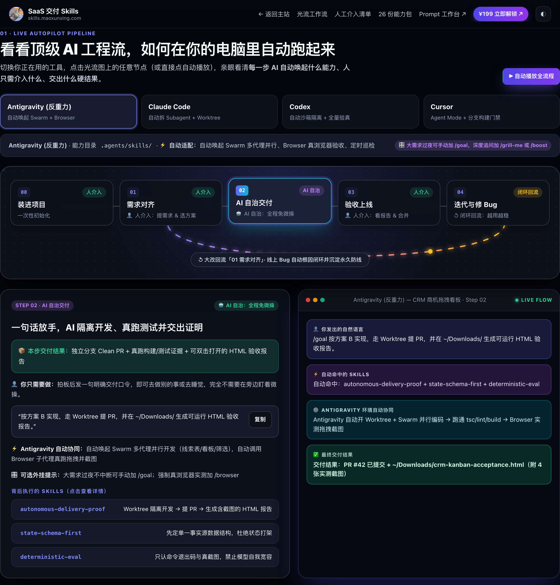

<div align="center">

<a href="https://skills.maoxunxing.com/">
  
</a>

<br />

# ⚡ agent-skills

### **One Developer. A 10x Frontend Engineering Team.**
**28 battle-tested Agent Skills for shipping production Frontend SaaS — specs first, live trend-scouted UI variants, brownfield contract guards, three-layer automated proof, zero fake fixes.**

<p>
  <a href="https://skills.maoxunxing.com/">
    
  </a>
</p>

<p>
  
  
  
  
  
</p>

**English** | [简体中文](./README.zh-CN.md) · [🌐 Interactive Visual Workflow](https://skills.maoxunxing.com/) · [🧭 Browserly Agent Matrix](https://browserly.maoxunxing.com/) · [🧠 Prompt Studio](https://prompts.maoxunxing.com/) · [🚀 Full Playbook & 1v1 Setup](https://maoxunxing.com/zh-cn/consult/)

</div>

---

## 🔥 Why 90% of AI-Built SaaS Projects Stall Halfway

| | ❌ Traditional Vibe Coding (Chat & Pray) | ⚡ With `agent-skills` Installed |
| :--- | :--- | :--- |
| **Before Coding** | Jumps straight into code in 10 seconds, builds the wrong thing for 6 hours | **`challenge-and-plan`**: challenges assumptions, asks 3 sharp questions, gives 3 trade-off options first |
| **During Execution** | Breaks working features, mixes unrelated refactors, forgets rules by turn 5 | **Isolated worktrees + state-schema-first**: clean atomic commits, ~95% rule retention |
| **Quality & Proof** | AI grades its own homework and says *"all tests pass!"* while the page is broken | **Deterministic verification**: real build/lint/test exit codes + real browser screenshots + standalone HTML acceptance report |
| **Bug Fixes** | Slaps `if (!x) return` band-aids on symptoms; same bug returns next week | **`bug-root-cause` + `systematic-debugging`**: reproduces first, fixes upstream root cause, locks in regression guards |

---

## 🌐 Live 4-Host Interactive Workflow

**Click the preview below to launch the interactive animated workflow & live 4-host theater at [skills.maoxunxing.com](https://skills.maoxunxing.com/) →**

<a href="https://skills.maoxunxing.com/#workflow">
  
</a>

> **Human-in-the-Loop, Zero Micromanagement:** You only step in at 3 high-leverage checkpoints — **① Approve the plan → ② Review the HTML acceptance report & merge PR → ③ Report bugs / new features**. Everything in between runs autonomously, automatically adapting to your host's native superpowers (**Antigravity Swarm & Browser**, **Claude Code Subagents & Worktree**, **Codex Sandbox**, **Cursor Agent Mode**).

---

## 🛡️ Three-Layer Automated Verification & v0.13 Deep Evaluator

**95% of QA runs autonomously with zero self-grading — you only spend 30 seconds signing off the standalone HTML proof.**

<a href="https://skills.maoxunxing.com/#verification">
  
</a>

- **Layer 1 · Deterministic Code, Data & Logic Engine (`src/gate/rules/`)**
  - **Data completeness & brownfield mutability**: tracks whether declared TS fields are actually **consumed** in runtime code (`data-spec-field-unconsumed`), enforces `frozen` & `additive-only` brownfield protocol redlines, and validates live HTTP responses (`inputs.apiContractResults`).
  - **Executable Logic Spec + Property-Based Testing**: replaces comment-only checks with real passing test bindings (`inputs.logicSpec` + Jest/Vitest/Playwright `testResults`), state-machine enum & transition coverage, and `fast-check` PBT verification.
- **Layer 2 · Real Browser Walkthrough + DOM Audit**
  - Runs interactive journeys in a fresh context (`interactive-review`), audits computed layout (`inputs.domAuditResults`: horizontal overflow, clipped/overlapping elements, font scale drift, opt-in Tailwind arbitrary escapes), and binds every artifact to its **SHA-256** hash so nothing can be tampered with post-review.
- **Layer 3 · 30-Second Human Sign-Off**
  - Subjective taste (`verify: "human"`) and production merges always belong to you — delivered via an offline, double-clickable HTML acceptance report.

---

## ⚡ How It Adapts to Your AI Coding Tool (Isolation Boundaries)

| Host Environment | Skills Directory | Isolation Mechanism | Optional Power Switches |
| :--- | :--- | :--- | :--- |
| **Antigravity** | `.agents/skills/` | Dynamic **Swarm** multi-agent board + sandboxed **Browser** subagent | `/goal` (overnight), `/grill-me`, `/boost`, `/schedule` |
| **Claude Code** | `.claude/skills/` | Static 4 role subagents (`.claude/agents/*.md`) + `git worktree` | `/plan` (`Shift+Tab`), `/compact`, `/loop` |
| **Codex** | `.agents/skills/` | Isolated branch/worktree execution + deterministic build & test gates | Background multi-step execution |
| **Cursor** | `.agents/skills/` | Agent Mode constraint enforcement + branch isolation + terminal/MCP checks | Plan / Ask mode for Step 01 |

---

## 📦 28 Battle-Tested Skills (Outcome-First)

Every Skill is an **executable deliverable contract** — not vague advice. Includes **3-Layer Automated Verification** (deterministic commands + real browser interactive SHA-bound walkthrough + 30s human sign-off), **Brownfield Contract Guard** (`templates/standards/brownfield-contract.md`), **`ui-variants-studio`** (live GitHub / `shadcn` / `21st.dev` scouting → 3–5 clickable HTML prototypes before coding), and **`momo-browserly-advisor`** (first-party verified browser agent & MCP selection powered by [browserly.maoxunxing.com](https://browserly.maoxunxing.com/)). Explore free copy-ready templates at **[skills.maoxunxing.com](https://skills.maoxunxing.com/#skills)**:

- **Meta Workflows (5)**: `challenge-and-plan` · `ui-variants-studio` · `autonomous-delivery-proof` · `codebase-archaeology-audit` · `repo-community-patrol`
- **Specs & Contracts (6)**: `clarify-requirements` · `write-prd` · `write-quality-vision` · `write-tech-design` · `write-dev-plan` · `write-acceptance-criteria`
- **Implementation & Debugging (3)**: `implement-task` · `systematic-debugging` · `fix-from-report`
- **Deterministic Eval, Review & Browser Tooling (5)**: `deterministic-eval` · `e2e-testing` · `api-testing` · `interactive-review` · `momo-browserly-advisor`
- **Ship Gates & Memory (2)**: `ship-checklist` · `sync-overview`
- **Frontend Craft (7)**: `context-map` · `plan-before-code` · `state-schema-first` · `component-from-design` · `i18n-extract` · `bug-root-cause` · `verification-before-completion`

---

## 🚀 Get Started in 60 Seconds

1. **Explore the visual workflow & copy free sample Skills**: 👉 **[https://skills.maoxunxing.com](https://skills.maoxunxing.com/)**
2. **Try the Bilingual AI Prompt Studio (35 free + 20 original PRO SOPs)**: 👉 **[https://prompts.maoxunxing.com](https://prompts.maoxunxing.com/)**
3. **Want the complete curated Notion workspace + 1v1 repo setup?** 👉 **[https://maoxunxing.com/zh-cn/consult/](https://maoxunxing.com/zh-cn/consult/)**

<details>
<summary><strong>🛠️ Advanced: CLI Kernel & Local Repo Installation</strong></summary>

```bash
git clone https://github.com/XingMXTeam/agent-skills.git
cd agent-skills && npm install
```

See the full architecture notes at [maoxunxing.com/en/frontend-ai-collaboration-design/](https://maoxunxing.com/en/frontend-ai-collaboration-design/).

</details>

---

<div align="center">
  <strong>Built by <a href="https://maoxunxing.com/">Momo (@maoxunxing)</a></strong> · Former NetEase &amp; Alibaba Senior Frontend Engineer (11 yrs) · Indie Maker
  <br />
  If this helps you ship cleaner SaaS faster, drop a ⭐ on this repo!
</div>
