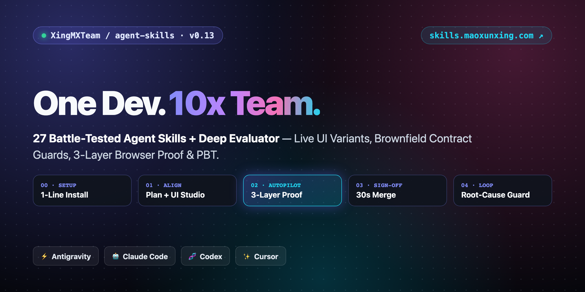
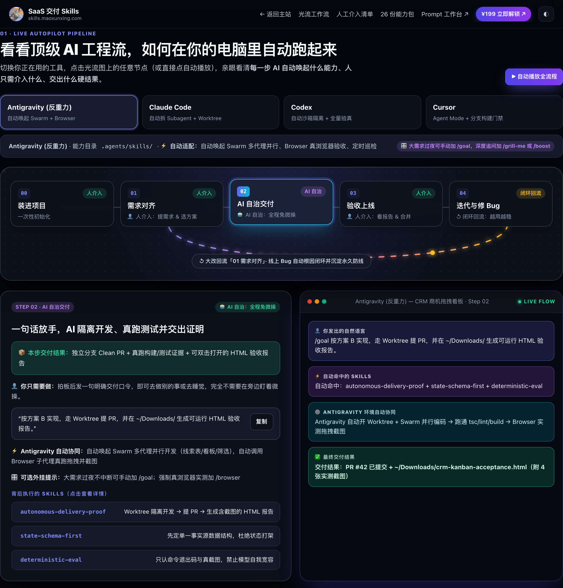
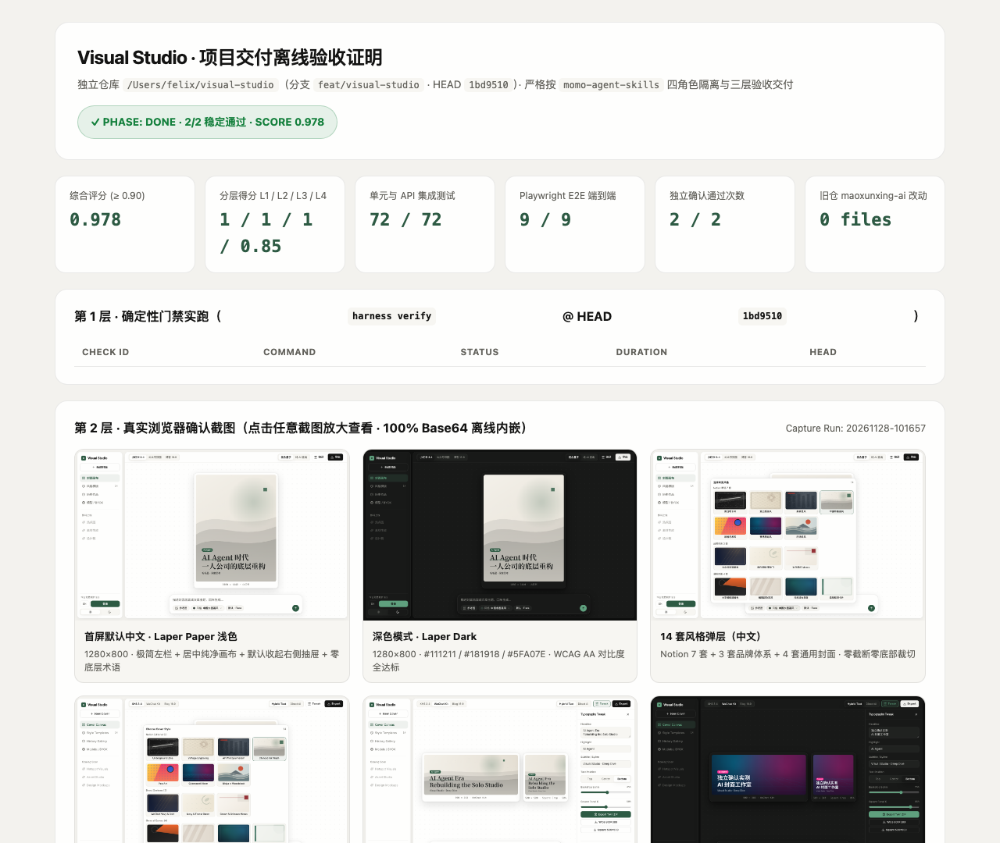
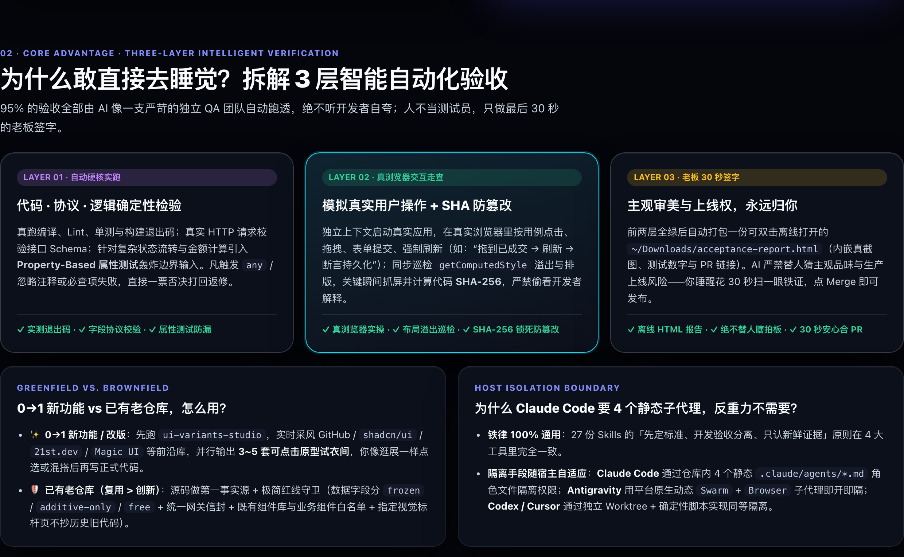

 

# 🛡️ ShipProof

### **先验真，再上线。拒绝 AI 自己给自己打满分。**
**面向 AI 编程 Agent 的独立三层验真与高质量交付引擎 —— 确定性代码/协议/PBT 属性测试门禁、真浏览器交互走查、SHA-256 防篡改离线 HTML 验收报告、老仓库红线守卫，以及 27 份可执行交付 Skills。**

  

  
  
  
  
  
  

[English](./README.md) | **简体中文** · [📖 设计说明书 (`SPEC.md`)](./SPEC.md) · [🧾 真实交付证明 (`HTML`)](./examples/visual-studio-acceptance-report.html) · [🌐 可视化光流工作流](https://skills.maoxunxing.com/) · [🧠 Prompt 工作台](https://prompts.maoxunxing.com/) · [🔥 实战知识库 &amp; 1v1 陪跑](https://maoxunxing.com/zh-cn/consult/)

---

## 🔥 为什么 90% 用 AI 写 SaaS 的项目都会半路烂尾？

| 维度 | ❌ 传统 Vibe Coding（靠聊天赌运气） | 🛡️ 装上 **ShipProof**（验真 + 27 份交付契约）之后 |
| :--- | :--- | :--- |
| **写码之前** | 拿到模糊需求十秒开写，自由发挥六小时方向全错 | **`challenge-and-plan`**：先读仓挑刺、问清 3 个关键问题，给 3 版带取舍方案拍板 |
| **开发过程** | 改好 A 搞坏 B、爱顺手重构无关文件、聊到第 5 轮彻底失忆 | **独立 Worktree 隔离 + 状态先行**：原子提交、长流程规则保留率 ~95% |
| **质量验收** | AI 自己写代码自己夸“已全部通过”，一打开全是报错 | **确定性硬验收**：只认真实构建/测试退出码 + 真浏览器实测截图 + 可双击 HTML 验收报告 |
| **线上修 Bug** | 报错点加一句 `if (!x) return` 糊弄过去，下周继续炸 | **`bug-root-cause` + `systematic-debugging`**：强制先复现、定位上游根因、沉淀防复发规则 |

---

## 🌐 四端自动适配 · 可视化光流交付大图

**点击下方大图，直接前往 [skills.maoxunxing.com](https://skills.maoxunxing.com/) 切换 Antigravity / Claude Code / Codex / Cursor 实时演练全流程 →**

> **人只做关键决策，其余全由 AI 自治跑完：** 你只在 **① 立项拍板方案 → ② 睡醒看 HTML 验收报告点合并 → ③ 报 Bug / 提新需求** 这 3 个节点介入；中间的并行编码、浏览器实测与提 PR，Skill 会根据你的工具环境自动唤起最强原生能力。

---

## 📋 工作流每一步做什么？交付什么产物？（Step 1 → Step 4）

ShipProof 的每一步都有**严格的角色边界**和**落盘可验证的交付物**，绝不靠“口头总结”交差：

| 步骤 | 阶段与角色 | 这一步做什么 | 这一步产生的具体交付物 |
| :--- | :--- | :--- | :--- |
| **第 1 步** | **需求对齐与契约锁定** `clarify` · Planner + 👤 你 | 先读仓挑刺、问清关键问题、给出 3 版取舍方案供拍板；0→1 新页面先用 `ui-variants-studio` 实时采风出 3~5 套可点击原型定调，老仓库用 `brownfield-contract` 锁死数据与组件红线；写代码前先把需求、质量锚点、技术设计与验收清单全部锁死。 | • `.harness/tasks/<f>/clarification/`（`questions.md` / `answers.md` / `summary.md`） • `prd.md`（`REQ-n` 需求契约）+ `vision.md`（`REF / ANTI / RL` 质量锚点） • `tech-design.md` + `pages.json`（路由清单）+ `tasks.json` + `plan.md`（可编辑边界） • `rubric.json`（分层验收基线 + 一票否决红线）+ `e2e-cases.json` • *（可选）* 3~5 套可点击 HTML 试衣间原型 或 `brownfield-contract.md` |
| **第 2 步** | **隔离开发与原子提交** `implement` · Developer 🤖 | 在独立 `git worktree` / 分支中按 `tasks.json` 逐个原子任务推进实现；通过内核白名单隔离，**开发者看不到 `rubric.json` 评分细则**，彻底杜绝“对着考卷答案硬凑分数”；每做完一个任务即提交独立 Commit 并更新状态机。 | • 独立分支上的原子提交记录（例如下方真实案例的 `TASK-1` ~ `TASK-6`） • 业务源码 + 单元测试 / API 集成测试 / Playwright E2E 测试套件 • `.harness/tasks/<f>/state.json`（磁盘原子状态机，记录每个任务 Commit SHA，随时断点续跑） |
| **第 3 步** | **三层独立验真与自动返修** `evaluate → review → verify` · Evaluator + Reviewer 🤖 | 独立验收官与审查员（完全看不到开发者的过程笔记）先跑第 1 层确定性代码/协议/逻辑/PBT 门禁，再跑第 2 层真浏览器交互走查 + 计算样式 DOM 审计 + SHA-256 防篡改；遇 `fail` 或一票否决自动走 `replan → remediate` 定向返修；通过后清空上下文做二次独立确认（`2/2` 稳定通过）。 | • `.harness/verify.json`（绑定当前 Git `HEAD` 的真实构建/Lint/测试退出码记录） • `evaluation/report-*.json`（三态裁决、L1–L4 分层得分与 Veto 记录） • `review/report.json` + 桌面/移动端真机浏览器截图（SHA-256 哈希锁死防篡改） • 定向返修 Commit（例如针对交互问题 `RB-27` 的 `1bd9510` 修复提交） |
| **第 4 步** | **30 秒离线签字、上线与沉淀** `done` · 👤 你 + 长期记忆 | 前两层全绿且二次确认通过后，自动打包为一份双击即可离线打开的 HTML 验收证明；你花 30 秒扫一眼核心指标、真机截图与签字清单即可 Merge 上线；合入后自动同步项目记忆并把历史踩坑沉淀为永久防线。 | • **可双击离线打开的 HTML 交付验收证明**（见下方真实案例） • `harness report <f>` 原始交付报告 + Clean PR / 合并记录 • 更新后的 `.harness/overview/`（`sync-overview`）与 `.harness/project-rules.json`（`fh learn` 永久规则） |

### 🧾 真实项目交付证明示例（`Visual Studio`）

下方就是用 ShipProof 跑完一个真实项目后，**第 4 步自动生成的离线 HTML 交付验收证明**（完整文件已放入本仓库 👉 **[`examples/visual-studio-acceptance-report.html`](./examples/visual-studio-acceptance-report.html)**，下载后双击即可在浏览器离线打开，点击任意截图支持放大查看）：

- **最终裁决**：`PHASE: DONE` · **`2/2`** 清上下文独立确认通过 · **综合评分 `0.978`**（L1 `1.0` / L2 `1.0` / L3 `1.0` / L4 `0.85`）· **0 项一票否决**
- **硬核实跑**：**`72 / 72`** 单元与 API 集成测试 + **`9 / 9`** Playwright E2E 端到端用例 + 旧仓库 **`0 files`** 误改
- **一页铁证**：内置 **10 张 100% Base64 离线真机截图**（浅/深色、中/英文、桌面 `1280×800` 与移动 `390×844`、弹层/抽屉/焦点裁切实测）、老板 30 秒签字清单、原始 `harness report` 与完整原子 `git log`（`TASK-1`–`TASK-6` + `RB-27` 返修记录）。

---

## 🛡️ 为什么敢直接去睡觉？三层智能自动化验收 × v0.13 深度评测引擎

**95% 的验收全部由 AI 自动跑透并绑定防篡改证据，人不当测试员，只做最后 30 秒的老板签字。**

- **第 1 层 · 代码、数据协议与逻辑硬核实跑（`src/gate/rules/`）**
  - **数据真实消费与老仓库红线**：剥离类型声明后检查字段是否在业务代码里真正被消费（`data-spec-field-unconsumed`），强制拦截破坏 `frozen` / `additive-only` 老仓库协议红线的改动，并校验真实接口返回（`inputs.apiContractResults`）。
  - **可执行逻辑规格 + 属性测试（PBT）**：彻底告别“写句 `// FP-1` 注释就能糊弄过关”，强制绑定真实通过的 Jest / Vitest / Playwright 用例、状态机枚举与转换覆盖，以及 `fast-check` 属性测试门禁。
- **第 2 层 · 真浏览器交互走查 + 计算样式 DOM 审计**
  - 独立上下文实操交互（`interactive-review`），结合浏览器 `getComputedStyle` 巡检横向溢出、文本截断、元素重叠与字号阶梯漂移（`inputs.domAuditResults`），并为目标产物绑定 **SHA-256** 防篡改。
- **第 3 层 · 老板 30 秒签字放行**
  - 主观审美与生产上线风险永远归你——前两层全绿后打包为可双击离线打开的 HTML 验收报告，你睡醒扫一眼铁证点 Merge 即可。

> 📖 **想彻底搞懂背后的 Why & How？** 为什么坚持「一票否决压倒平均分」「三态裁决」「SHA-256 防篡改」以及「0→1 与老仓库分轨治理」？查看面向新手也能看懂的完整架构与决策说明书 👉 **[`SPEC.md`](./SPEC.md)**

---

## ⚡ 一套能力包，自动适配 4 大主流 AI 编程工具（隔离边界）

| 你在用的工具 | 自动读取目录 | 开发 / 验收隔离机制 | 可选手动外挂开关 |
| :--- | :--- | :--- | :--- |
| **Antigravity (反重力)** | `.agents/skills/` | 平台原生动态 **Swarm** 多代理 + 独立 **Browser** 沙箱子代理 | `/goal`（过夜）、`/grill-me`、`/boost`、`/schedule` |
| **Claude Code** | `.claude/skills/` | 仓库内 4 个静态角色子代理（`.claude/agents/*.md`）+ `git worktree` | `/plan`（`Shift+Tab`）、`/compact`、`/loop` |
| **Codex** | `.agents/skills/` | 独立分支 / 沙箱隔离 + 全量确定性构建与测试门禁 | 后台异步多步执行 |
| **Cursor** | `.agents/skills/` | Agent Mode 规则约束 + 分支隔离 + 终端/MCP 验收 | 立项阶段可切 Plan / Ask 模式 |

---

## 📦 27 份实战 Skills 一览（每一份都交付确定结果）

包含 **三层智能自动化验收**（代码/接口实跑 + 真浏览器交互走查与 SHA 防篡改 + 老板 30 秒看报告签字）、**老仓库增量红线模板**（`templates/standards/brownfield-contract.md`）与 **实时采风 UI 试衣间（`ui-variants-studio`）**。前往 **[skills.maoxunxing.com](https://skills.maoxunxing.com/#skills)** 可免费直接复制 6 份核心样本试跑：

- **核心工作流 Meta Skills（5 份）**：`challenge-and-plan` · `ui-variants-studio` · `autonomous-delivery-proof` · `codebase-archaeology-audit` · `repo-community-patrol`
- **需求与契约（6 份）**：`clarify-requirements` · `write-prd` · `write-quality-vision` · `write-tech-design` · `write-dev-plan` · `write-acceptance-criteria`
- **实现与调试（3 份）**：`implement-task` · `systematic-debugging` · `fix-from-report`
- **确定性验收与走查（4 份）**：`deterministic-eval` · `e2e-testing` · `api-testing` · `interactive-review`
- **上线与长期记忆（2 份）**：`ship-checklist` · `sync-overview`
- **前端工程手艺（7 份）**：`context-map` · `plan-before-code` · `state-schema-first` · `component-from-design` · `i18n-extract` · `bug-root-cause` · `verification-before-completion`

---

## 🚀 立即开始

- **🌐 体验可视化光流工作流 & 免费复制 5 份核心 Skill**：[https://skills.maoxunxing.com](https://skills.maoxunxing.com/)
- **🧠 高频实战双语 Prompt 工作台（35 免费 + 20 原创 PRO）**：[https://prompts.maoxunxing.com](https://prompts.maoxunxing.com/)
- **🔥 打包带走完整 Notion 实战知识库（¥199）或预约 1v1 配进你的项目（¥799）**：[https://maoxunxing.com/zh-cn/consult/](https://maoxunxing.com/zh-cn/consult/)

---

  <strong>作者：<a href="https://maoxunxing.com/zh-cn/">毛毛星 Momo (@maoxunxing)</a></strong> · 前网易 / 阿里 11 年资深前端 · AI 独立开发者
   
  如果这套体系帮你省下了熬夜改 Bug 的时间，欢迎顺手点一个 ⭐ Star！

