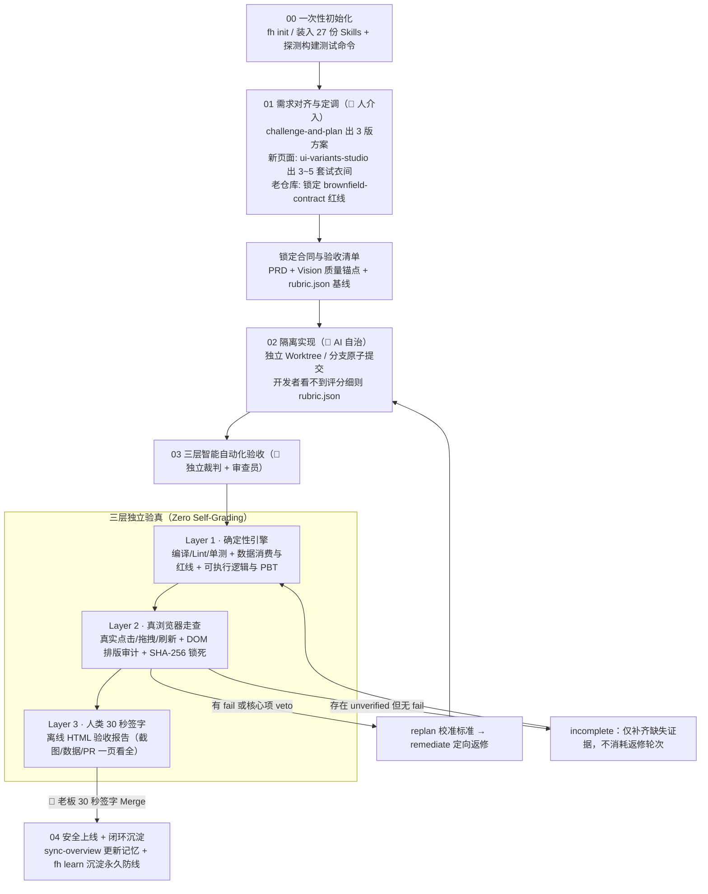

# 🛡️ ShipProof 设计说明书（Why & How）

> **阅读指南**：这篇文档完整记录了 **ShipProof** 的底层思考（**Why — 为什么要这么设计、踩过什么坑、做过哪些取舍**）与实现机制（**How — 整套验真与交付流水线具体怎么跑起来**）。
> 即使你是刚接触 AI 编程的新手，也能顺着这篇文档看懂每一条设计决策背后的原因。

---

## 0. 30 秒看懂 ShipProof：它到底在解决什么问题？

用 AI 写代码最常见的噩梦，其实可以用一个生活比喻讲透：

> **你不能让“写作业的学生”自己批改自己的试卷。**

在传统的聊天写码（Vibe Coding）里，同一个 AI 既当产品经理、又当程序员、还当测试员。结果往往是：
- 你提了一个模糊想法，AI 10 秒就开始狂写代码，写到第 5 轮彻底忘记最早定下的规则；
- 它一边改 A 页面，一边顺手把原本好好的 B 页面改崩；
- 最后它自己看一眼自己写的代码，自信地告诉你：**「所有功能已完美实现，测试全部通过！」**——结果你一打开浏览器，按钮点不动、数据刷新就丢、手机端排版全炸。

**ShipProof 的核心思路只有一句话：**
> **把「写代码」和「验代码」彻底拆开，用确定性脚本 + 真浏览器实测 + 防篡改铁证来把关；95% 的脏活累活交给 AI 自治闭环，人类只在最值钱的 3 个节点拍板。**

| 传统聊天写码的 5 大翻车现场 | ShipProof 的对应解法 |
| :--- | :--- |
| **聊久了失忆**，换个会话前功尽弃 | **文件即状态**：所有进度与证据落在 `.harness/` 磁盘文件，随时断点续跑 |
| **AI 自己给自己打满分**，口头“已通过” | **角色隔离 + 三层独立验真**：开发者不能自评，验收官看不到开发者的“辩解” |
| **平均分很高，但核心功能是坏的** | **一票否决（Veto）**：核心必查项为 0 或踩红线直接判死刑，绝不被高平均分掩盖 |
| **没测过被当成“通过”或糊弄过去** | **三态裁决（通过 / 失败 / 未验证）**：缺证据就是 `unverified`，绝不伪造分数 |
| **改老项目乱动接口和样式** | **0→1 与老仓库分轨**：新页面先采风出原型试衣间；老仓库锁死字段与组件红线 |

---

## 第一部分：WHY —— 10 个核心架构决策与取舍复盘

下面这 10 条决策，每一条都来自真实项目里踩过的坑。每条我们都讲清楚：**遇到什么痛点 → 最终怎么定 → 为什么不选别的方案**。

### 决策 1：文件是唯一状态源，绝不信任聊天记忆
- **痛点**：大模型的上下文窗口会压缩、会遗忘，过夜跑任务或重启 IDE 后，靠聊天记录记住“做到第几步了”必然断片。
- **怎么做**：每一次状态流转都通过确定性命令原子写入 `state.json`（先写临时文件再 `rename`，防止写一半崩溃损坏）。`fh next` 是一个纯函数：**只要给定当前 `state.json` + 配置文件，下一步该干什么就是 100% 确定的**。
- **为什么不放内存里**：因为随时可能杀掉进程、重启电脑、切换会话。无状态内核 + 磁盘状态机，才能支持长周期任务和跨进程自动化测试。

### 决策 2：内核永不直接调大模型，只当「确定性裁判与调度器」
- **痛点**：如果工具自己内置一套 LLM 调用循环，不仅要维护各家 API 密钥、流式解析和工具调用协议，而且迭代速度永远追不上 Antigravity / Claude Code / Codex / Cursor 这些专业宿主。
- **怎么做**：ShipProof 内核本身 **0 次调用大模型**。规划、写码、交互审查都由你正在用的宿主 Agent 执行；内核只负责产出标准化的任务包（`packet`）、执行确定性脚本检查、验证证据真伪并推进状态机。
- **为什么这样更优**：便宜、可 100% 离线复现测试、零厂商锁定——未来无论哪家编程 Agent 变强，ShipProof 都能直接白嫖它的最新能力。

### 决策 3：能用脚本算死的绝不让 AI 猜，裁判（Judge）必须关进笼子
- **痛点**：让大模型“凭感觉”看代码打分，同一份代码上午打 95 分、下午打 60 分，根本没法当上线门禁。
- **怎么做**：把验收项明确分层：
  1. **确定性探针优先**：`command`（真实命令退出码）、`file`（文件存在）、`grep`（规则匹配）、`scan`（代码扫描器）、`verify`（绑定 Git HEAD 的验证记录）——全部由脚本铁面无私地判定。
  2. **AI 裁判（`judge`）被严格限权**：只用于脚本实在没法判断的语义/视觉项，且必须遵守三条铁律：① 分数只能从固定集合 `{0, 0.5, 1}` 里选；② 必须提交结构化证据文件；③ 证据缺失、过期或格式不对，一律记为 `unverified`（未验证），绝不瞎猜分数。

### 决策 4：一票否决（Veto）压倒平均分
- **痛点**：这是整个系统里**最重要的一条规则**。AI 非常擅长把 10 个不痛不痒的小细节都做到 100 分，把加权平均分刷到 92 分，但最核心的“点击支付/保存按钮”其实是死的。
- **怎么做**：验收清单（`rubric.json`）里的核心项标记为 `essential`，红线项标记为 `pitfall`。**只要任意一个 `essential` 得分为 0，或任意一个 `pitfall` 被触发，无论加权总分多高，整次验收直接判 `fail`（一票否决）。**

### 决策 5：三态结果（`pass / fail / unverified`）——「没测过」不是分数
- **痛点**：早期版本只有通过/失败两态，导致两个坏结果：① 还没来得及跑浏览器测试就被算成 0 分，白白浪费一次 AI 返修循环；② 或者缺少基线截图被静默当成“通过”。
- **怎么做**（v0.12 引入）：
  - 每个检查项的结果改为三态：`pass`（通过）、`fail`（失败）、`unverified`（未验证）。
  - 加权得分只按**已验证项**计算。
  - 整体裁决新增 **`incomplete`（待补验）**：如果没有已确定的失败项，只是存在未验证项，状态机停在补验环节，**绝不触发返修、绝不消耗返修轮次预算**。
  - 但如果是核心必查项或红线项处于 `unverified`，遵循安全工程的 **Fail-Closed（宁错杀不放过）** 原则，直接拒绝放行。

### 决策 6：信息隔离是机制，不是“求 AI 自觉”
- **痛点**：光在 Prompt 里写“请你客观公正地验收”几乎没用——只要验收 AI 看到了开发 AI 的思考过程和“我为了省事所以这么写”的辩解，它就会天然共情并放水。
- **怎么做**（从协议审计升级到内核机制）：
  1. **按角色白名单发包**（`src/roles.js`）：开发者拿到的任务包里不包含 `rubric.json` 评分细则；验收官拿到的包里**严禁夹带开发者的过程记录**，驱动层发现泄露直接拒发。
  2. **角色权限锁**（`HARNESS_ROLE`）：不同角色只能调用属于自己的命令——验收官不能写实现记录，开发者不能提交验收打分。
  3. **证据新鲜度 + SHA-256 防篡改**：证据的时间戳必须晚于最新代码提交；审查报告对被审查产物计算 **SHA-256 哈希**，只要代码或截图后来被改过一个字节，旧报告立刻作废。
  4. **二次确认必须清上下文**：自动收口前的最终确认，必须在干净的新上下文里重新生成证据，绝不允许复用上一轮的旧笔记。

### 决策 7：验收标准只能越收越紧，禁止 AI 偷偷“和稀泥”
- **痛点**：AI 遇到修不好的 Bug 时，常有一种“聪明但危险”的冲动——把验收标准改松一点，不就通过了吗？
- **怎么做**：验收失败后进入 `replan` 环节时，验收官可以提出完善标准的建议（比如补漏掉的边界用例），但 `replan-done` 强制校验：**增加或细化规则可以自动通过；任何试图删除核心项（`essential` / `pitfall`）或降低验收等级的修改，必须经过人类显式批准**。标准只会越用越锋利，永远不会被 AI 悄悄降级。

### 决策 8：0→1 新功能 vs 已有老仓库，必须分轨治理
- **痛点**：新项目从零画界面和在 10 万行老仓库里加一个字段，完全是两种工程逻辑。用一套规则硬套，要么新页面做得像毫无美感的 AI 模板，要么改老仓库时把线上的接口字段和设计规范改得面目全非。
- **怎么做**：
  - **0→1 新功能 / 全新改版（Greenfield）**：先跑 `ui-variants-studio`，实时去 GitHub / `shadcn/ui` / `21st.dev` / `Magic UI` 采风，并行生成 **3~5 套可点击的独立 HTML 原型试衣间**。你像逛展一样挑出最对味的一套（或混搭），定调后再写正式业务代码。
  - **已有老仓库（Brownfield，复用 > 创新）**：把**源码作为第一事实源**，叠加一份极简红线契约（`templates/standards/brownfield-contract.md`）：
    - 数据字段分三级：`frozen`（绝对禁止改名/删改类型）、`additive-only`（只允许新增可选字段）、`free`（新模块自由演进）；
    - 锁定统一网关信封结构，禁止接口私自换返回格式；
    - 锁定既有 UI 组件库与内部业务组件白名单，并指定 1~2 个视觉标杆页（防止 AI 抄到仓库里的历史烂代码）。

### 决策 9：核心铁律 100% 通用，但隔离手段随工具自适应
- **痛点**：不同用户的 AI 编程工具能力差别很大——比如 Claude Code 原生支持 `.claude/agents/*.md` 静态子代理文件，而 Antigravity 原生支持动态 `Swarm` 多代理和内置 `Browser` 子代理，Codex/Cursor 又各有侧重。
- **怎么做**：
  - **不变的是铁律**：先定合同、开发验收分离、三层验真、只认新鲜证据——这套原则在 4 大工具里 100% 一致。
  - **变化的是隔离载体**：
    - **Antigravity**：动态 `Swarm` 协作 + 沙箱 `Browser` 子代理即开即隔；
    - **Claude Code**：仓库内 4 个静态角色文件（`.claude/agents/{planner,developer,evaluator,reviewer}.md`）+ `git worktree`；
    - **Codex / Cursor**：独立分支 / Worktree + 确定性校验脚本与终端/MCP 门禁。

### 决策 10：预算耗尽就暂停，每次踩坑都沉淀成永久防线
- **痛点**：无人值守跑任务最怕两件事——① AI 陷入死循环一晚上烧光几百块 Token；② 今天花两小时修完的坑，下周 AI 又踩一遍。
- **怎么做**：
  - **硬预算熔断**：轮次、重试次数、步数、时长任一触顶，任务自动转入 `paused`（暂停）并写明原因，必须由人类 `fh resume` 才能重启计数，绝不静默死循环。
  - **越用越稳的闭环学习**（`fh learn`）：从历史失败报告里提炼错误类型，按**约束强度从高到低**给出升级建议：`构建门禁（gate） > 项目红线（project-pitfall） > 确定性规则 > 单任务提示 > 文档规范`。被采纳的规则会写入 `.harness/project-rules.json`，以后每个新功能验收时自动生效，同类 Bug 永不复发。

---

## 第二部分：HOW —— ShipProof 具体是怎么跑起来的？

看懂了“为什么”，现在看“怎么做”。下面用一个真实需求（比如「给后台加一个商机拖拽看板」）走完一整条链路。

### 1. 端到端流水线全景图



> **人的精力花在哪？**
> 整条链路里，你只需要在 **3 个高杠杆节点** 露面：**① 拍板方案与视觉方向 → ② 睡醒花 30 秒看离线 HTML 报告点 Merge → ③ 报新需求或线上 Bug**。中间的编码、单测、浏览器走查、打回返修全部自动闭环。

---

### 2. 三层智能自动化验收（3-Layer Verification）深度拆解

这是 ShipProof 与普通提示词集合拉开代差的引擎核心（v0.12–v0.13）：

#### Layer 1：确定性代码、数据协议与逻辑引擎（`src/gate/rules/`）
不听 AI 解释，直接拿代码、协议和真实测试跑分：

| 维度 | 核心源码 | 具体查什么？（小白也能懂的例子） |
| :--- | :--- | :--- |
| **结构正确性** | `src/gate/rules/structure.js` | 自动探测本地 `tsc` 真跑 `tsc --noEmit`；检查无效导入、类型逃逸（`any` / `@ts-ignore`）与运行时隐患 |
| **数据完整性 & 老仓库红线** | `src/gate/rules/data.js` | 1. 逐字段比对代码 TS 类型与协议 Spec，缺字段/类型错直接扣分；<br/>2. **真实消费检查**（`data-spec-field-unconsumed`）：剥离类型声明后，检查协议里声明的字段在业务代码里到底有没有真被用到；<br/>3. **老仓库红线守卫**：拦截对 `frozen` 字段的破坏性修改、对 `additive-only` 的删除/改型；<br/>4. 校验真实 HTTP 返回（`apiContractResults`）是否符合网关信封和契约 |
| **逻辑正确性 & 属性测试 PBT** | `src/gate/rules/logic.js` | 1. 告别以前“写句 `// FP-1` 注释就能糊弄过关”的做法，要求每个功能点绑定**真实通过的 Jest / Vitest / Playwright 测试**（`inputs.logicSpec` + `testResults`）；<br/>2. 检查状态机枚举值与状态转换是否全覆盖；<br/>3. 支持 **`fast-check` 属性测试（Property-Based Testing）**，自动生成成百上千组边界随机输入轰炸金额计算、状态流转等复杂逻辑 |
| **端到端实跑** | `src/gate/rules/e2e.js` | 直接执行项目测试脚本（`--run-tests`），解析真实通过数与失败数，跑不通直接记为未验证而非静默放行 |

#### Layer 2：真浏览器交互走查 + 计算样式 DOM 审计 + SHA-256 防篡改（`src/review.js` + `src/gate/rules/ui.js`）
单测全绿不代表页面能用（白屏、按钮被遮挡、手机端横向撑破都靠这层抓）：
- **真实用户操作走查**（`verify: "interactive"`）：每条交互验收项必须写明可执行断言（`assert`），由独立的 **Reviewer（审查员）** 角色在新浏览器上下文里真实执行（例如：「把卡片拖到『已成交』→ 硬刷新页面 → 断言卡片仍在『已成交』且总金额更新」）。
- **计算样式 DOM 审计**（`inputs.domAuditResults`）：在真实浏览器里读取 `getComputedStyle`，自动揪出**横向溢出、文字截断、元素重叠、字号阶梯漂移**（以及可选开启的 Tailwind 任意值逃逸检查）。
- **像素级视觉回归**（`harness capture` + `harness visual`）：使用 `pixelmatch` 对比真实 PNG 截图；空白图直接失败，缺少基线报 `no-baseline`（绝不假装匹配）。
- **SHA-256 防篡改锁定**：验收报告自动记录被审查文件和截图的 SHA-256 哈希值——如果在验收之后又偷偷改了代码，合并门禁会立刻发现哈希不一致并驳回。

#### Layer 3：老板 30 秒离线签字（`verify: "human"`）
- **为什么坚持保留最后 30 秒人工签字？** 因为“审美高级不高级”“文案对不对品牌调性”“现在能不能推生产”是主观与业务风险决策，**AI 严禁替人拍板**。
- 前两层全部跑绿后，自动打包一份可双击离线打开的 **HTML 验收报告**（内嵌真机桌面/移动端截图、各层测试数字、DOM 审计结果与 PR 链接），你花 30 秒扫一眼铁证，确认满意点 Merge 即可上线。

---

### 3. 代码库地图：每个核心文件干什么用？

如果你想直接读源码或二次定制，看这张地图就能一秒定位：

```text
ShipProof/
├── bin/harness.js                 # CLI 入口（支持 fh / harness 两个命令别名）
├── src/
│   ├── orchestrate.js             # 核心状态机：纯函数 nextAction，决定下一步干什么
│   ├── state.js                   # 磁盘状态读写（原子 write-then-rename，v1→v2 自动迁移）
│   ├── roles.js                   # 4 角色权限边界与白名单发包（防开发者记录泄露给验收官）
│   ├── rubric.js                  # 验收清单校验（分母覆盖率、四层权重、必查项约束）
│   ├── evaluate.js                # 裁决引擎（三态结果、一票否决 Veto、incomplete 路由）
│   ├── review.js                  # Layer 2 审查打包、合并与 SHA-256 产物哈希校验
│   ├── evidence.js                # 证据新鲜度校验、防自报规则、截图有效性校验
│   ├── verify.js                  # fh verify：绑定 Git HEAD 的确定性验证记录器
│   ├── refine.js                  # replan 规则收紧校验（只允许变严，放松需人类批准）
│   ├── learn.js                   # fh learn：从失败报告提炼共性坑并升级为永久防线
│   ├── run.js                     # 轻量驱动层：衔接状态机与宿主 Agent CLI（零内部状态）
│   └── gate/                      # 五维代码与深度评测传感器（v0.13 Deep Evaluator）
│       ├── config.js              # 评测配置加载与默认阈值
│       ├── artifacts.js           # 测试报告 / DOM 审计 / 接口契约产物解析器
│       └── rules/
│           ├── structure.js       # 结构正确性（tsc --noEmit / 导入 / 类型逃逸）
│           ├── data.js            # 数据消费 + 老仓库 frozen/additive-only 红线 + API 契约
│           ├── logic.js           # 可执行逻辑规格绑定 + 状态机 + fast-check PBT
│           ├── ui.js              # 视觉像素 diff + 计算样式 DOM 审计
│           └── e2e.js             # 端到端测试套执行与结果解析
├── templates/
│   ├── skills/                    # 27 份可执行交付 Skills（每份均含英文执行版 + 中文阅读版）
│   ├── standards/                 # 技术栈规范包（nextjs / react / vue / node）+ brownfield-contract.md
│   └── claude-code/agents/        # Claude Code 静态 4 角色子代理模板
└── test/                          # 168+ 自动化测试（含 deep-evaluator.test.js 与技能黄金集）
```

---

### 4. 27 份交付 Skills 的定位：它们不是“提示词鸡汤”，而是可执行契约

ShipProof 把 27 份 Skills 按交付阶段分成 6 组，每一份都写死了 **「何时触发 → 执行步骤 → 反模式禁令 → 确定交付物」**：

- **核心工作流 Meta Skills（5 份）**：`challenge-and-plan`（先挑刺出 3 方案）· `ui-variants-studio`（实时采风 3~5 套原型试衣间）· `autonomous-delivery-proof`（过夜自治交付与铁证）· `codebase-archaeology-audit`（老仓库考古与包袱清理）· `repo-community-patrol`（社区 Issue/PR 巡检）
- **需求与契约（6 份）**：`clarify-requirements` · `write-prd` · `write-quality-vision` · `write-tech-design` · `write-dev-plan` · `write-acceptance-criteria`
- **实现与根因调试（3 份）**：`implement-task` · `systematic-debugging` · `fix-from-report`
- **独立验真与走查（4 份）**：`deterministic-eval` · `e2e-testing` · `api-testing` · `interactive-review`
- **上线门禁与记忆（2 份）**：`ship-checklist` · `sync-overview`
- **前端工程手艺（7 份）**：`context-map` · `plan-before-code` · `state-schema-first` · `component-from-design` · `i18n-extract` · `bug-root-cause` · `verification-before-completion`

---

### 5. 我们刻意「不做」什么？（Non-Goals）

明确边界和明确目标一样重要，以下几件事是 ShipProof 刻意不做的：
1. **不自建大模型运行时**：不包揽模型路由、计费和上下文压缩，永远让专业宿主工具做它最擅长的事。
2. **不搞无约束的多任务黑盒并发**：内核状态流转刻意保持串行清晰，因为乱序并发会成倍放大“改 A 坏 B、状态打架”的失败面（需要并行时，交给宿主原生的 Worktree / Swarm 在受控隔离边界内完成）。
3. **绝不伪造无法执行的检查**：缺少截图基线就报 `no-baseline`，缺测试产物就报 `unverified`，绝不用占位图或“推测通过”来凑绿灯。
4. **不绑定单一前端框架**：内核本身与技术栈解耦，所有 React / Next.js / Vue / Node 规则全部外置在 `templates/standards/` 规范包中。

---

## 第三部分：版本演进记录（v0.1 → v0.13）

如果你想追溯每一项机制是在什么背景下长出来的，下面是完整演进脉络：

- **v0.13.0 — 深度评测引擎与品牌升级为 ShipProof**：
  - 仓库正式由 `momo-agent-skills` 升级更名为 **ShipProof**（突出「先验真、再上线」核心价值）。
  - `src/gate/rules/data.js` 新增剥离类型声明后的真实字段消费校验（`data-spec-field-unconsumed`）、老仓库 `frozen` / `additive-only` 变更红线守卫与真实接口返回契约校验（`apiContractResults`）。
  - `src/gate/rules/logic.js` 从“注释打标”升级为可执行逻辑规格绑定真实通过测试（Jest / Vitest / Playwright）、状态机枚举/转换覆盖与 `fast-check` 属性测试（PBT）门禁。
  - `src/gate/rules/ui.js` 新增浏览器真实 `getComputedStyle` 排版与溢出审计（`domAuditResults`）。
  - 新增第 27 号 Skill **`ui-variants-studio`**（0→1 实时采风原型试衣间）与 **`templates/standards/brownfield-contract.md`**（老仓库增量变更红线模板）；自动化测试覆盖增至 **168/168 全绿**。
- **v0.12.0 — 三态裁决与三层独立审查层**：
  - 检查项结果升级为三态（`pass / fail / unverified`），引入 `incomplete` 待补验裁决（不烧返修预算），核心必查项/红线项未验证按 Fail-Closed 拦截。
  - 新增 `verify` 维度（`static` / `interactive` / `human`）、第四角色 **Reviewer**、`review-pack` / `review-merge` 以及 **SHA-256 产物防篡改绑定**；状态文件升至 v2（自动兼容迁移 v1）。
- **v0.11.0 — 证据绑定与闭环学习**：
  - 新增 `fh verify`（将命令、退出码、Git `HEAD` 与完整日志落盘至 `.harness/verify/last.json`），裁判正面打分必须引用在当前 `HEAD` 通过的验证记录。
  - 新增 `fh learn` 与 `fh learn adopt`，将历史失败报告沉淀为 `.harness/project-rules.json` 永久红线。
- **v0.10.0 — 极简体验优化**：
  - 新增 `fh` 短命令别名与当前特性记忆（`.harness/current`）、`fh done` 智能推进、`init` 自动探测技术栈并注入 `CLAUDE.md` / `AGENTS.md` 与 SessionStart 钩子。
- **v0.9.0 — 既有 PRD 无损导入**：
  - 支持 `harness new <f> --prd <file>` 直接导入已有 PRD 并提取 `REQ-n` 编号种子，澄清阶段自动收窄为“确认 + 补缺口”。
- **v0.8.0 — UI 维度像素级对比**：
  - `inputs.visualResults` 接入 `harness visual` 像素 diff 报告，无基线报中立 `no-baseline`，五大评测维度全部打通真实执行/产物路径。
- **v0.7.0 — 传感器从“看静态文件”升级为“真跑构建与测试”**：
  - `structure` 自动探测本地 `tsc --noEmit`；`e2e` 支持 `--run-tests` 真实执行项目测试套。
- **v0.6.0 — 数据维度契约比对**：
  - `inputs.dataSpec` 接入协议 JSON，逐字段比对代码 TypeScript 接口与协议定义。
- **v0.5.0 — 角色隔离、证据抓取与 13 份作者链 Skills**：
  - 落地 `planner / developer / evaluator` 角色白名单发包与 `HARNESS_ROLE` 权限拦截；引入 `replan` 只紧不松机制；落地 `harness capture`（Playwright 真图）与 `harness visual`（`pixelmatch`）；补齐完整双语 `SKILL.md` + `SKILL.zh-CN.md`。
- **v0.1 – v0.4 — 确定性状态机与传感器统一**：
  - 确立“文件即状态、内核不调 LLM、Veto 压倒平均分、通用内核 + 技术栈规范包、单一裁决权（合并原 `ai-code-gate` 与 `harness-skills`）”等奠基原则。
